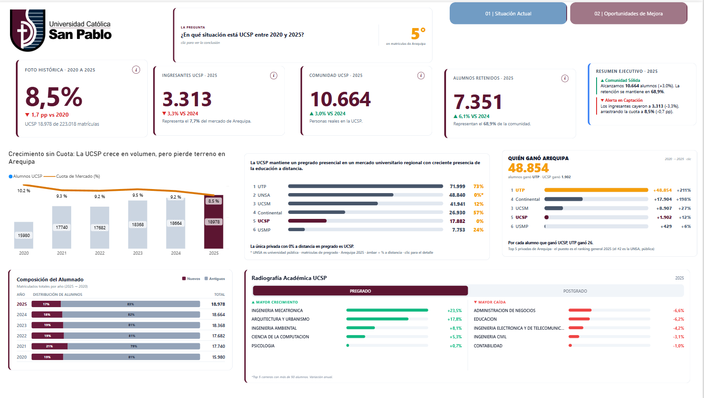
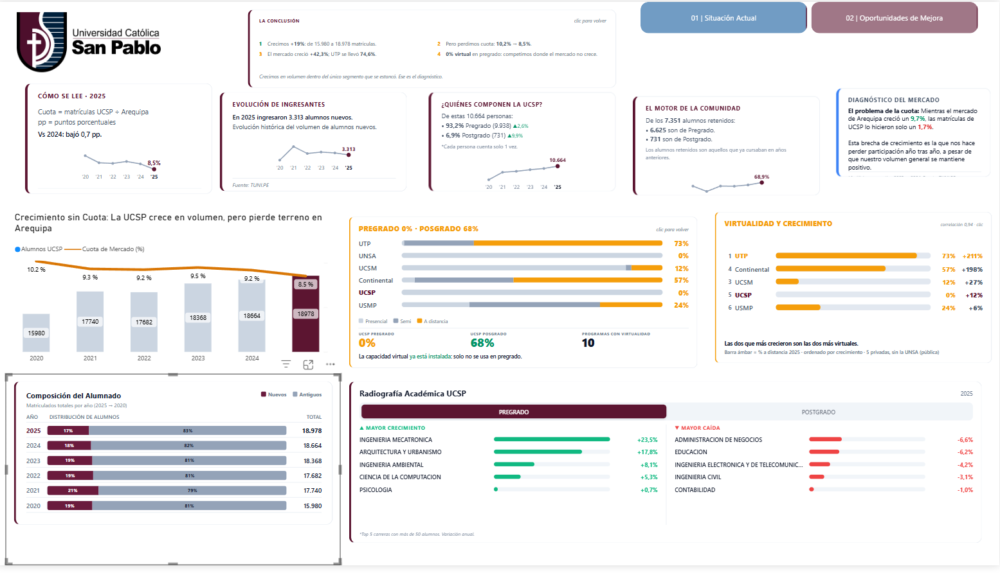
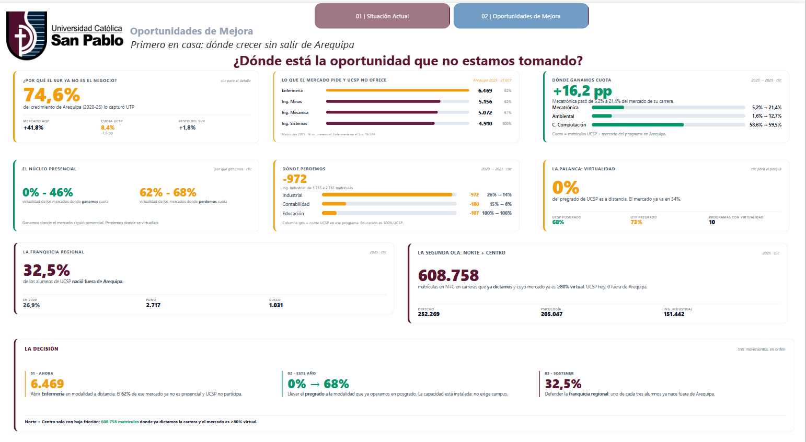
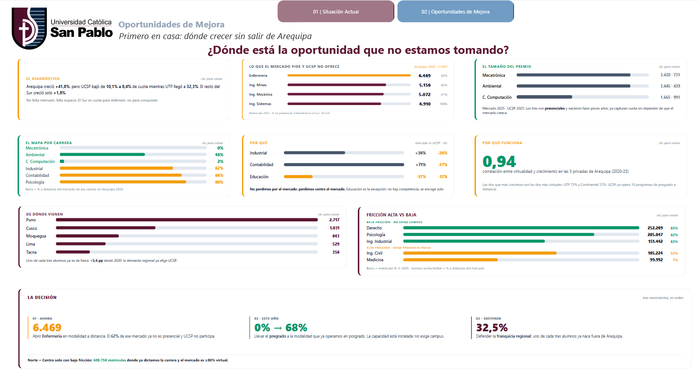

# UCSP Market Intelligence — Dónde Crecer

**Un tablero de dos páginas que convierte 17,4 millones de registros de matrícula fragmentados en un caso de crecimiento listo para comité.**

`Power BI` · `DAX (46 medidas)` · `Python` · `Esquema estrella Kimball` · `HTML/CSS dentro de DAX`

[English](README.md) · **Español**

---

## Vista del tablero

**Página 1 — Situación Actual**



**Página 1 — con todas las tarjetas volteadas: el diagnóstico detrás de cada KPI**



**Página 2 — Oportunidades: dónde crecer**



**Página 2 — con todas las tarjetas volteadas: la evidencia detrás de cada titular**



---

## El problema de negocio

Una universidad privada de Arequipa (UCSP) tomaba decisiones de portafolio — qué carreras abrir, sostener o cerrar, y hacia dónde expandirse — sin una visión consolidada de la demanda ni de la posición competitiva.

Los datos que deberían responder esas preguntas se publican como archivos semestrales: nombres de carrera inconsistentes, filas duplicadas, campos de sede y modalidad vacíos, y ningún benchmark competitivo confiable.

**Resultado: las decisiones de crecimiento se tomaban por intuición.** Mientras tanto, la cuota de mercado se erosionaba en silencio.

## Los datos

| | |
|---|---|
| Fuente | [SUNEDU / TUNI](https://tuni.pe/datos) — datasets públicos de matrícula |
| Alcance | 2020 – 2025, cobertura nacional |
| Tabla de hechos limpia | **17.368.424** registros de matrícula |
| Universidades comparadas | **174** |
| Ofertas de programa | **6.189** |
| Zonas analíticas | Norte · Centro · Sur |

El pipeline va de CSV crudo → Bronce → Silver (limpieza) → Gold → un esquema estrella agregado: 5 dimensiones (universidad, programa, periodo, geografía, sede) y dos tablas de hechos.

## El enfoque analítico: data storytelling

Un tablero que muestra números es un reporte. Un tablero que termina en una decisión es un producto. El reporte está construido como **dos actos**:

```
PÁGINA 1 — SITUACIÓN ACTUAL        PÁGINA 2 — OPORTUNIDADES DE MEJORA
"¿Qué está pasando?"               "¿Qué hacemos al respecto?"

1. La pregunta                    1. El freno       — el mercado ya está asignado
2. Cuatro KPIs                    2. El hueco       — demanda que no atendemos
3. Tendencia vs mercado           3. La prueba      — dónde sí ganamos cuota
4. Quién se lleva el mercado      4. La regla       — por qué ganamos ahí
5. De dónde vienen los alumnos    5. El costo       — dónde perdemos y por qué
                                  6. La palanca     — la capacidad ya está instalada
                                  7. La base        — una franquicia regional propia
                                  8. La segunda ola — entrada a nuevo mercado
                                  9. La decisión    — tres acciones, en orden
```

Cada tarjeta es una **tarjeta volteable**: un número grande al frente y el diagnóstico al reverso. La página se lee en 20 segundos en la capa frontal, o se defiende línea por línea en el reverso.

## Hallazgos clave

**1. Crecemos en volumen mientras perdemos posición.**
Las matrículas subieron **+19%** (15.980 → 18.978) pero la cuota cayó de **10,1% a 8,4%**: una fuga de **−1,6 pp**. Crecer no es ganar.

**2. El crecimiento ya estaba asignado.**
El mercado de Arequipa creció **+41,8%** entre 2020 y 2025. **UTP capturó el 74,6% de esa expansión.** UCSP ocupa el **5.º** lugar de 6 en la ciudad.

**3. El diferenciador es la modalidad, no la marca.**
La oferta de pregrado de UCSP es **100% presencial (0% a distancia)** mientras las dos instituciones que más crecieron son **73%** y **57%** a distancia. Correlación entre virtualidad del mercado y crecimiento en las 5 privadas: **0,94**.

**4. Pero la capacidad ya existe en casa.**
El **68%** del posgrado de UCSP ya opera en modalidad a distancia o híbrida, en **10 programas**. La restricción no es tecnológica: es una decisión de portafolio que nunca se trasladó al pregrado.

**5. La demanda que no atendemos es medible.**
Enfermería representa **6.469** matrículas en Arequipa, **+124%** en cinco años, **62%** ya no presencial — y UCSP no la ofrece.

**6. Nuestra franquicia regional es real y creciente.**
El **32,5%** de los alumnos de UCSP nació fuera de Arequipa (26,9% en 2020). Principales orígenes: Puno **2.717**, Cusco **1.031**, Moquegua **643**.

**7. Entrar a un mercado nuevo es un problema de dimensionamiento, no de deseo.**
Norte + Centro representa **2.817.633** matrículas. De ese total, **608.758** están en carreras que UCSP ya dicta y cuyo mercado es **≥80% virtual**: la entrada **no requiere campus nuevo**.

## Recomendaciones estratégicas (el caso de negocio)

| # | Acción | Evidencia | Perfil de inversión |
|---|---|---|---|
| **01** | Abrir **Enfermería** a distancia | 6.469 matrículas, +124%, 62% ya no presencial, 0% de participación UCSP | Baja — sin infraestructura nueva |
| **02** | Trasladar la **modalidad de posgrado** al pregrado | Brecha 0% → 68% ya resuelta internamente, 10 programas operando | Baja — la capacidad está instalada |
| **03** | Defender la **franquicia regional** | 1 de cada 3 alumnos ya viene de fuera de Arequipa | Baja — retención, no captación |
| **04** | Entrar a **Norte + Centro** solo donde la fricción es baja | 608.758 matrículas en carreras existentes | Media — secuenciada después de 01–03 |

El orden importa: **defender y digitalizar en casa antes de expandirse.** Entrar a regiones nuevas con un modelo 100% presencial replicaría la misma desventaja estructural a mayor escala.

## Aspectos técnicos destacados

- **46 medidas DAX**, **20 de ellas tarjetas HTML codificadas a mano** dentro del modelo — incluyendo interacción de volteo con `<input type="checkbox">` + `<label>`, sin visuales personalizados externos.
- **Tooltips y estados de hover**: tooltips informativos en cada tarjeta KPI y atributos `title` dentro de las tarjetas HTML, para que el detalle viva un nivel abajo y el lienzo quede limpio.
- **Theming dinámico**: cada tarjeta resuelve Light/Dark desde una tabla de selección, de modo que todo el reporte cambia de tema sin duplicar visuales.
- **Tarjetas totalmente parametrizadas**: ninguna cifra está escrita a mano. Todo se calcula desde el modelo, incluidos coeficientes de correlación (`AVERAGEX`/`SUMX`/`POWER`/`SQRT`).
- **Denominadores determinísticos**: las series de cuota de mercado usan filtros explícitos en lugar de `ALLSELECTED`, para que un filtro del visual nunca altere el ratio en silencio.
- **Consistencia auditada**: cada cifra mostrada se contrastó contra el modelo, lo que detectó una métrica presentada con un grano distinto al resto (todos los niveles vs pregrado) y se corrigió.
- **Sistema de color accesible**: el granate de marca no cumple contraste como texto (1,28:1), por lo que se usa solo en bordes y rellenos, reservando un tono más claro (4,9:1) para tipografía.

## Stack técnico

| Capa | Herramientas |
|---|---|
| Extracción y limpieza | Python, pandas, Jupyter |
| Modelado | Esquema estrella Kimball, Power BI (TMDL / PBIP) |
| Métricas | DAX (inteligencia de tiempo, control de contexto de filtro, HTML dinámico) |
| Presentación | Power BI + HTML/CSS inyectado vía DAX |
| Control de versiones | Git, definiciones de modelo en texto TMDL |

## Estructura del repositorio

```
notebooks/     01-09: exploración de esquemas → limpieza → esquema estrella → agregación
src/           scripts ETL aditivos e idempotentes (modalidad, dimensión de programa, origen)
dashboard/     proyecto Power BI (PBIP): modelo semántico en TMDL + definición del reporte
features/      especificaciones, registro de tareas y decisiones por funcionalidad
spec/          contratos de datos, principios de modelado y puertas de calidad
docs/          dossier técnico
assets/        capturas del tablero
```

## Nota sobre honestidad de los datos

- Este proyecto usa **únicamente datos públicos de matrícula**. No hay estado de resultados, ingresos por aranceles ni datos de costos.
- Por eso, lo "financiero" se expresa como **volumen de alumnos direccionable** — un proxy de demanda — nunca como moneda.
- Cada cifra de este README es reproducible desde los notebooks y el modelo semántico.

## Proyecto complementario

Una prueba técnica separada (SUNEDU) validó habilidades de extracción de datos y renderizado HTML/DAX bajo presión de tiempo. Ese repositorio es un ejercicio de validación de habilidades; **este es el caso de negocio.**

## Cómo abrirlo

1. Instalar **Power BI Desktop** (2.130 o superior).
2. Activar **Preview features → Power BI Project (.pbip)** en *Archivo → Opciones y configuración → Opciones*.
3. Abrir `dashboard/demanda_UCSP.pbip`.

El reporte abre en modo **Light** por defecto. Los datos no están incluidos en el repositorio: el modelo semántico apunta a archivos parquet generados por los notebooks a partir de fuentes públicas de SUNEDU/TUNI.
