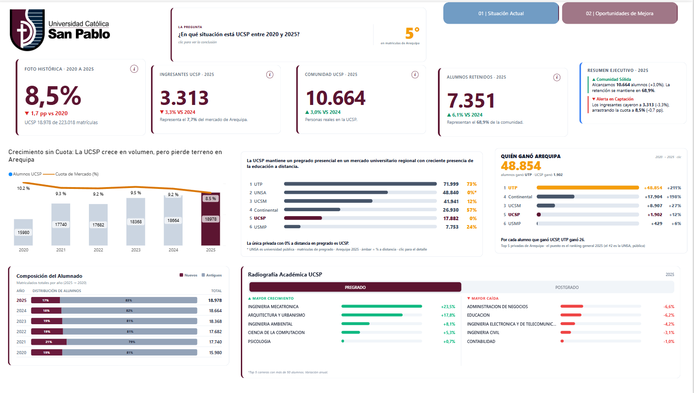
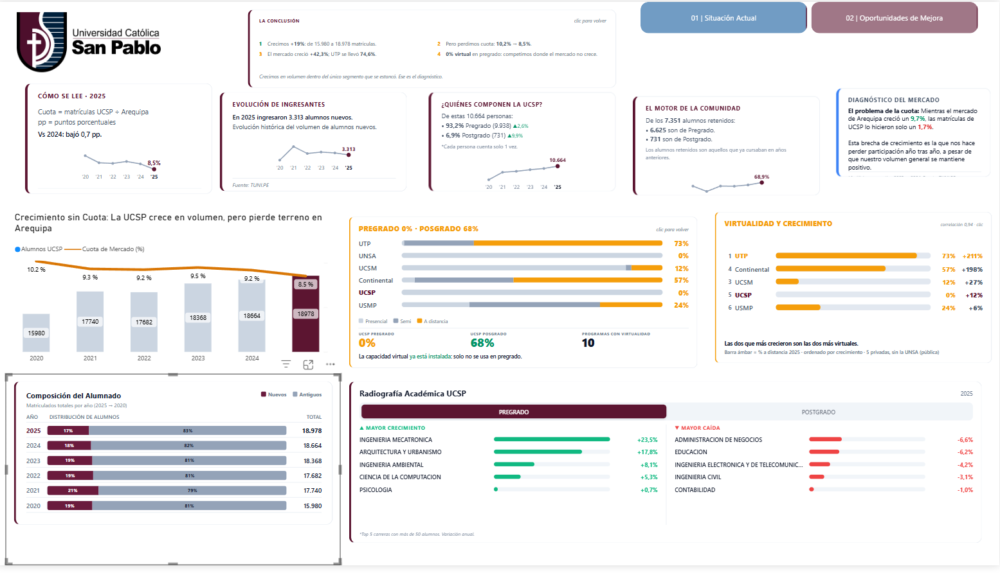
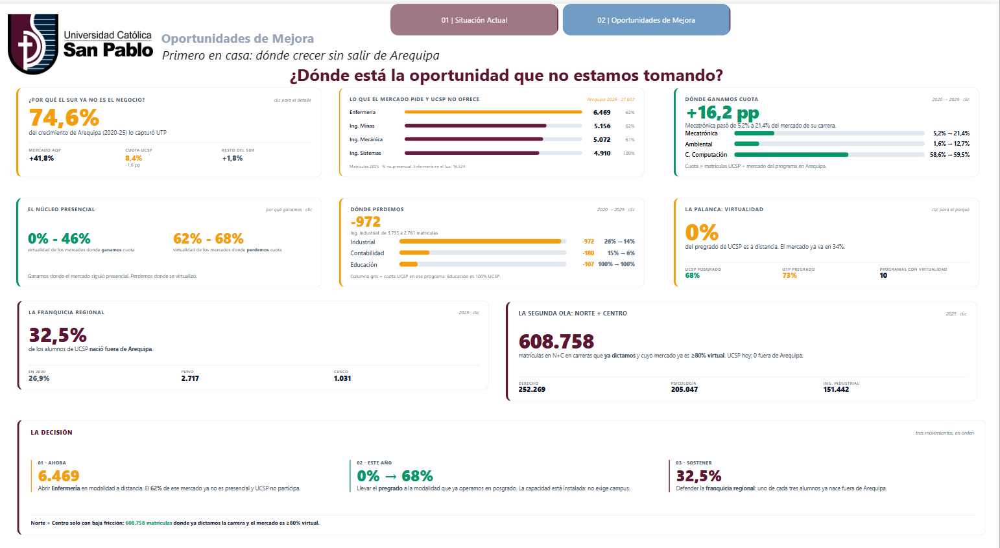
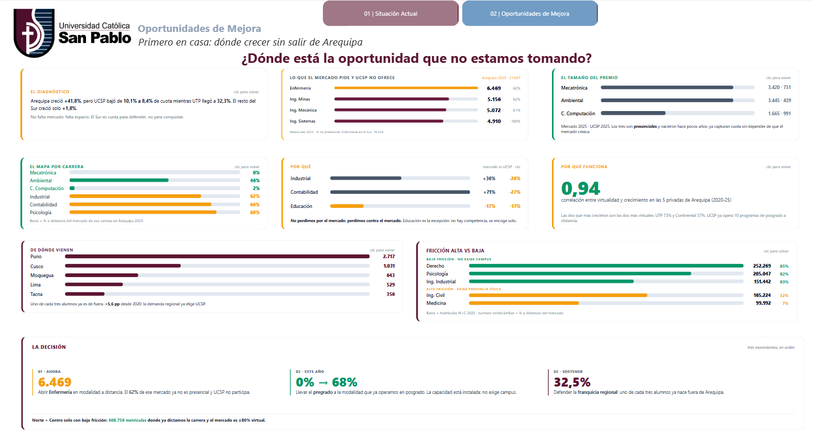

# UCSP Market Intelligence — Where to Grow Next

**A two-page BI decision deck that turns 17.4M fragmented enrollment records into a board-ready growth case for a Peruvian private university.**

`Power BI` · `DAX (46 measures)` · `Python` · `Kimball Star Schema` · `HTML/CSS inside DAX`

---

## Dashboard Preview

**Page 1 — Current Situation**



**Page 1 — every card flipped: the diagnosis behind each KPI**



**Page 2 — Opportunities: where to grow next**



**Page 2 — every card flipped: the evidence behind each headline**



---

## The Business Problem

A private university in Arequipa (UCSP) was making portfolio decisions — which programs to open, sustain or discontinue, and where to expand — without a consolidated view of demand or competitive position.

The data that should answer those questions is published as semester-level files: inconsistent program names, duplicated rows, missing campus and modality fields, and no reliable competitive benchmark.

**Result: growth decisions were being made on intuition.** Meanwhile, market share was quietly eroding.

## The Data

| | |
|---|---|
| Source | [SUNEDU / TUNI](https://tuni.pe/datos) public enrollment datasets |
| Raw scope | 2020 – 2025, national coverage |
| Cleaned fact table | **17,368,424** enrollment records |
| Universities benchmarked | **174** |
| Program offerings | **6,189** |
| Analytical zones | Norte · Centro · Sur |

The pipeline runs from raw CSV → Bronze → Silver (cleaned) → Gold → an aggregated star schema consumed by the report: 5 dimensions (university, program, period, geography, campus) plus two facts.

## The Analytical Approach: Data Storytelling

A dashboard that shows numbers is a report. A dashboard that ends in a decision is a product. The report is deliberately built as **two acts**:

```
PAGE 1 — SITUACIÓN ACTUAL          PAGE 2 — OPORTUNIDADES DE MEJORA
"What is happening?"               "What do we do about it?"

1. The question                   1. The brake      — the market is already allocated
2. Four headline KPIs             2. The gap        — demand we do not serve
3. Trend vs market                3. The proof      — where we do win share
4. Who is taking the market       4. The rule       — why we win there
5. Where our students come from   5. The cost       — where we lose, and why
                                  6. The lever      — capability already installed
                                  7. The base       — a regional franchise we own
                                  8. The second wave— new market entry
                                  9. The decision   — three actions, in order
```

Every card is a **flip card**: a headline number on the front, the diagnosis on the back. The deck can be read in 20 seconds at the front layer, or defended line by line on the back layer.

## Key Insights

**1. We are growing in volume while losing position.**
Enrollment rose **+19%** (15,980 → 18,978) but market share fell from **10.1% to 8.4%** — a **−1.6 pp** leakage. Growing is not the same as winning.

**2. The growth was already allocated.**
The Arequipa market expanded **+41.8%** between 2020 and 2025. **UTP captured 74.6% of that expansion.** UCSP ranks **5th** of 6 in the city.

**3. The differentiator is modality, not brand.**
UCSP's undergraduate offer is **100% on-campus (0% distance)** while the two institutions that grew fastest are **73%** and **57%** distance. Correlation between market virtuality and growth across the 5 private players: **0.94**.

**4. But the capability already exists in-house.**
**68%** of UCSP's postgraduate enrollment already runs in distance/hybrid modality, across **10 programs**. The constraint is not technology or know-how — it is a portfolio decision that was never transferred to undergraduate.

**5. The demand we do not serve is measurable.**
Nursing (Enfermería) represents **6,469** enrollments in Arequipa, **+124%** in five years, **62%** already non-presential — and UCSP does not offer it.

**6. Our regional franchise is real and growing.**
**32.5%** of UCSP students were born outside Arequipa (up from 26.9% in 2020). Top origins: Puno **2,717**, Cusco **1,031**, Moquegua **643**.

**7. New market entry is a sizing problem, not a wish.**
Norte + Centro represents **2,817,633** enrollments. Of that, **608,758** sit in programs UCSP already delivers and whose market is **≥80% virtual** — meaning entry requires **no new campus**.

## Strategic Recommendations (The Business Case)

| # | Action | Evidence | Investment profile |
|---|---|---|---|
| **01** | Launch **Nursing** in distance modality | 6,469 enrollments, +124%, 62% already non-presential, 0 UCSP share | Low — no new building |
| **02** | Transfer the **postgraduate modality** to undergraduate | 0% → 68% gap already solved internally, 10 programs running | Low — capability is installed |
| **03** | Defend the **regional franchise** | 1 in 3 students already comes from outside Arequipa | Low — retention, not acquisition |
| **04** | Enter **Norte + Centro** only where friction is low | 608,758 addressable enrollments in existing programs | Medium — sequenced after 01–03 |

The sequencing matters: **defend and digitize at home before expanding.** Entering new regions with a 100%-on-campus model would replicate the same structural disadvantage at a larger scale.

## Technical Highlights

- **46 DAX measures**, **20 of them hand-coded HTML cards** rendered inside the model — including flip-card interactions driven by `<input type="checkbox">` + `<label>`, no external custom visuals required.
- **Tooltips and hover states**: info tooltips on every KPI card plus `title` attributes inside the HTML cards, so the detail lives one level down and the canvas stays clean.
- **Dynamic theming**: every card resolves Light/Dark from a slicer table, so the entire report restyles without duplicating visuals.
- **Fully parameterized cards**: no hardcoded figures. Every number in every card is computed from the model, including correlation coefficients (`AVERAGEX`/`SUMX`/`POWER`/`SQRT`).
- **Audited consistency**: cross-checked every displayed figure against the semantic model, which caught a stale metric presented on a different level grain (all-levels vs undergraduate) and corrected it.
- **Accessibility-driven color system**: the brand maroon fails contrast as text (1.28:1), so it is used only for borders and fills, with a lighter tint (4.9:1) reserved for typography.

## Tech Stack

| Layer | Tools |
|---|---|
| Extraction & cleaning | Python, pandas, Jupyter |
| Modeling | Kimball star schema, Power BI (TMDL / PBIP) |
| Metrics | DAX (time intelligence, filter-context control, dynamic HTML) |
| Presentation | Power BI + HTML/CSS injected via DAX |
| Version control | Git, TMDL text-based model definitions |

## Repository Structure

```
notebooks/     01-09: schema exploration → cleaning → star schema → dashboard aggregation
src/           additive, idempotent ETL scripts (modality, program dimension, student origin)
dashboard/     Power BI project (PBIP): semantic model in TMDL + report definition
features/      specs, task logs and decision records per feature
spec/          data contracts, modeling principles and quality gates
assets/        dashboard screenshots
```

## A Note on Data Honesty

- This project uses **public enrollment data only**. There is no P&L, tuition revenue or cost data.
- "Revenue" is therefore expressed as **addressable student volume** — a demand proxy — never as currency.
- Every figure in this README is reproducible from the notebooks and the semantic model.

## Companion Project

A separate technical assessment (SUNEDU) validated data extraction and HTML/DAX rendering skills under time pressure. That repository is a skills validation exercise; **this one is the strategic case study.**

## How to Open

1. Install **Power BI Desktop** (2.130 or later).
2. Enable **Preview features → Power BI Project (.pbip)** in *File → Options and settings → Options*.
3. Open `dashboard/demanda_UCSP.pbip`.

The report opens in **Light** mode by default. Data is not bundled in the repository: the semantic model points to parquet files produced by the notebooks from public SUNEDU/TUNI sources.

---

# Español

**Un tablero de dos páginas que convierte 17,4 millones de registros de matrícula fragmentados en un caso de crecimiento listo para comité.**

## El problema de negocio

Una universidad privada de Arequipa (UCSP) tomaba decisiones de portafolio — qué carreras abrir, sostener o cerrar, y hacia dónde expandirse — sin una visión consolidada de la demanda ni de la posición competitiva.

Los datos que deberían responder esas preguntas se publican como archivos semestrales: nombres de carrera inconsistentes, filas duplicadas, campos de sede y modalidad vacíos, y ningún benchmark competitivo confiable.

**Resultado: las decisiones de crecimiento se tomaban por intuición.** Mientras tanto, la cuota de mercado se erosionaba en silencio.

## Los datos

| | |
|---|---|
| Fuente | Datasets públicos de matrícula SUNEDU / TUNI |
| Alcance | 2020 – 2025, cobertura nacional |
| Tabla de hechos limpia | **17.368.424** registros de matrícula |
| Universidades comparadas | **174** |
| Ofertas de programa | **6.189** |
| Zonas analíticas | Norte · Centro · Sur |

El pipeline va de CSV crudo → Bronce → Silver (limpieza) → Gold → un esquema estrella agregado: 5 dimensiones (universidad, programa, periodo, geografía, sede) y dos tablas de hechos.

## El enfoque analítico: data storytelling

Un tablero que muestra números es un reporte. Un tablero que termina en una decisión es un producto. El reporte está construido como **dos actos**:

```
PÁGINA 1 — SITUACIÓN ACTUAL        PÁGINA 2 — OPORTUNIDADES DE MEJORA
"¿Qué está pasando?"               "¿Qué hacemos al respecto?"

1. La pregunta                    1. El freno       — el mercado ya está asignado
2. Cuatro KPIs                    2. El hueco       — demanda que no atendemos
3. Tendencia vs mercado           3. La prueba      — dónde sí ganamos cuota
4. Quién se lleva el mercado      4. La regla       — por qué ganamos ahí
5. De dónde vienen los alumnos    5. El costo       — dónde perdemos y por qué
                                  6. La palanca     — la capacidad ya está instalada
                                  7. La base        — una franquicia regional propia
                                  8. La segunda ola — entrada a nuevo mercado
                                  9. La decisión    — tres acciones, en orden
```

Cada tarjeta es una **tarjeta volteable**: un número grande al frente y el diagnóstico al reverso. La página se lee en 20 segundos en la capa frontal, o se defiende línea por línea en el reverso.

## Hallazgos clave

**1. Crecemos en volumen mientras perdemos posición.**
Las matrículas subieron **+19%** (15.980 → 18.978) pero la cuota cayó de **10,1% a 8,4%**: una fuga de **−1,6 pp**. Crecer no es ganar.

**2. El crecimiento ya estaba asignado.**
El mercado de Arequipa creció **+41,8%** entre 2020 y 2025. **UTP capturó el 74,6% de esa expansión.** UCSP ocupa el **5.º** lugar de 6 en la ciudad.

**3. El diferenciador es la modalidad, no la marca.**
La oferta de pregrado de UCSP es **100% presencial (0% a distancia)** mientras las dos instituciones que más crecieron son **73%** y **57%** a distancia. Correlación entre virtualidad del mercado y crecimiento en las 5 privadas: **0,94**.

**4. Pero la capacidad ya existe en casa.**
El **68%** del posgrado de UCSP ya opera en modalidad a distancia o híbrida, en **10 programas**. La restricción no es tecnológica: es una decisión de portafolio que nunca se trasladó al pregrado.

**5. La demanda que no atendemos es medible.**
Enfermería representa **6.469** matrículas en Arequipa, **+124%** en cinco años, **62%** ya no presencial — y UCSP no la ofrece.

**6. Nuestra franquicia regional es real y creciente.**
El **32,5%** de los alumnos de UCSP nació fuera de Arequipa (26,9% en 2020). Principales orígenes: Puno **2.717**, Cusco **1.031**, Moquegua **643**.

**7. Entrar a un mercado nuevo es un problema de dimensionamiento, no de deseo.**
Norte + Centro representa **2.817.633** matrículas. De ese total, **608.758** están en carreras que UCSP ya dicta y cuyo mercado es **≥80% virtual**: la entrada **no requiere campus nuevo**.

## Recomendaciones estratégicas (el caso de negocio)

| # | Acción | Evidencia | Perfil de inversión |
|---|---|---|---|
| **01** | Abrir **Enfermería** a distancia | 6.469 matrículas, +124%, 62% ya no presencial, 0% de participación UCSP | Baja — sin infraestructura nueva |
| **02** | Trasladar la **modalidad de posgrado** al pregrado | Brecha 0% → 68% ya resuelta internamente, 10 programas operando | Baja — la capacidad está instalada |
| **03** | Defender la **franquicia regional** | 1 de cada 3 alumnos ya viene de fuera de Arequipa | Baja — retención, no captación |
| **04** | Entrar a **Norte + Centro** solo donde la fricción es baja | 608.758 matrículas en carreras existentes | Media — secuenciada después de 01–03 |

El orden importa: **defender y digitalizar en casa antes de expandirse.** Entrar a regiones nuevas con un modelo 100% presencial replicaría la misma desventaja estructural a mayor escala.

## Aspectos técnicos destacados

- **46 medidas DAX**, **20 de ellas tarjetas HTML codificadas a mano** dentro del modelo — incluyendo interacción de volteo con `<input type="checkbox">` + `<label>`, sin visuales personalizados externos.
- **Tooltips y estados de hover**: tooltips informativos en cada tarjeta KPI y atributos `title` dentro de las tarjetas HTML, para que el detalle viva un nivel abajo y el lienzo quede limpio.
- **Theming dinámico**: cada tarjeta resuelve Light/Dark desde una tabla de selección, de modo que todo el reporte cambia de tema sin duplicar visuales.
- **Tarjetas totalmente parametrizadas**: ninguna cifra está escrita a mano. Todo se calcula desde el modelo, incluidos coeficientes de correlación (`AVERAGEX`/`SUMX`/`POWER`/`SQRT`).
- **Consistencia auditada**: cada cifra mostrada se contrastó contra el modelo, lo que detectó una métrica presentada con un grano distinto al resto (todos los niveles vs pregrado) y se corrigió.
- **Sistema de color accesible**: el granate de marca no cumple contraste como texto (1,28:1), por lo que se usa solo en bordes y rellenos, reservando un tono más claro (4,9:1) para tipografía.

## Stack técnico

| Capa | Herramientas |
|---|---|
| Extracción y limpieza | Python, pandas, Jupyter |
| Modelado | Esquema estrella Kimball, Power BI (TMDL / PBIP) |
| Métricas | DAX (inteligencia de tiempo, control de contexto de filtro, HTML dinámico) |
| Presentación | Power BI + HTML/CSS inyectado vía DAX |
| Control de versiones | Git, definiciones de modelo en texto TMDL |

## Estructura del repositorio

```
notebooks/     01-09: exploración de esquemas → limpieza → esquema estrella → agregación
src/           scripts ETL aditivos e idempotentes (modalidad, dimensión de programa, origen)
dashboard/     proyecto Power BI (PBIP): modelo semántico en TMDL + definición del reporte
features/      especificaciones, registro de tareas y decisiones por funcionalidad
spec/          contratos de datos, principios de modelado y puertas de calidad
assets/        capturas del tablero
```

## Nota sobre honestidad de los datos

- Este proyecto usa **únicamente datos públicos de matrícula**. No hay estado de resultados, ingresos por aranceles ni datos de costos.
- Por eso, lo "financiero" se expresa como **volumen de alumnos direccionable** — un proxy de demanda — nunca como moneda.
- Cada cifra de este README es reproducible desde los notebooks y el modelo semántico.

## Proyecto complementario

Una prueba técnica separada (SUNEDU) validó habilidades de extracción de datos y renderizado HTML/DAX bajo presión de tiempo. Ese repositorio es un ejercicio de validación de habilidades; **este es el caso de negocio.**

## Cómo abrirlo

1. Instalar **Power BI Desktop** (2.130 o superior).
2. Activar **Preview features → Power BI Project (.pbip)** en *Archivo → Opciones y configuración → Opciones*.
3. Abrir `dashboard/demanda_UCSP.pbip`.

El reporte abre en modo **Light** por defecto. Los datos no están incluidos en el repositorio: el modelo semántico apunta a archivos parquet generados por los notebooks a partir de fuentes públicas de SUNEDU/TUNI.
